# 88x31

Animated 88×31 buttons in the old-web style. 187 so far.

千禧年风格的 88×31 动图按钮，目前 187 张。

Take whatever you like, no credit needed. Hover a button to see its file name.

喜欢就拿去用，不用署名。鼠标悬停可以看到文件名。

## AI

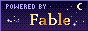

## Rhythm & music

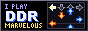

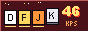

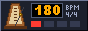
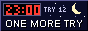

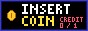

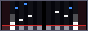
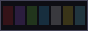
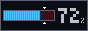

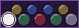

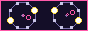
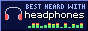

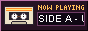

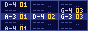
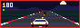

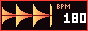
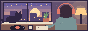
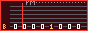

## osu!

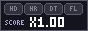

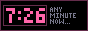

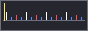

## Web 1.0

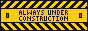
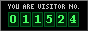

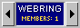
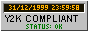
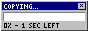

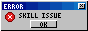

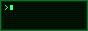
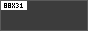
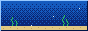

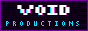

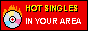

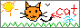

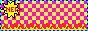

## Loops

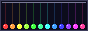
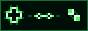

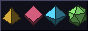
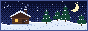
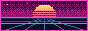

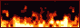
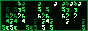

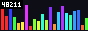

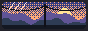
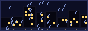

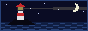

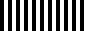
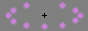

## Memes

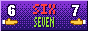

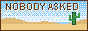

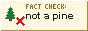

## Anime

## Crypto

## Notes

- The product and company names on the Now! buttons belong to their owners. These are fan buttons with no affiliation, and the icons are original drawings, not anyone's logo.
